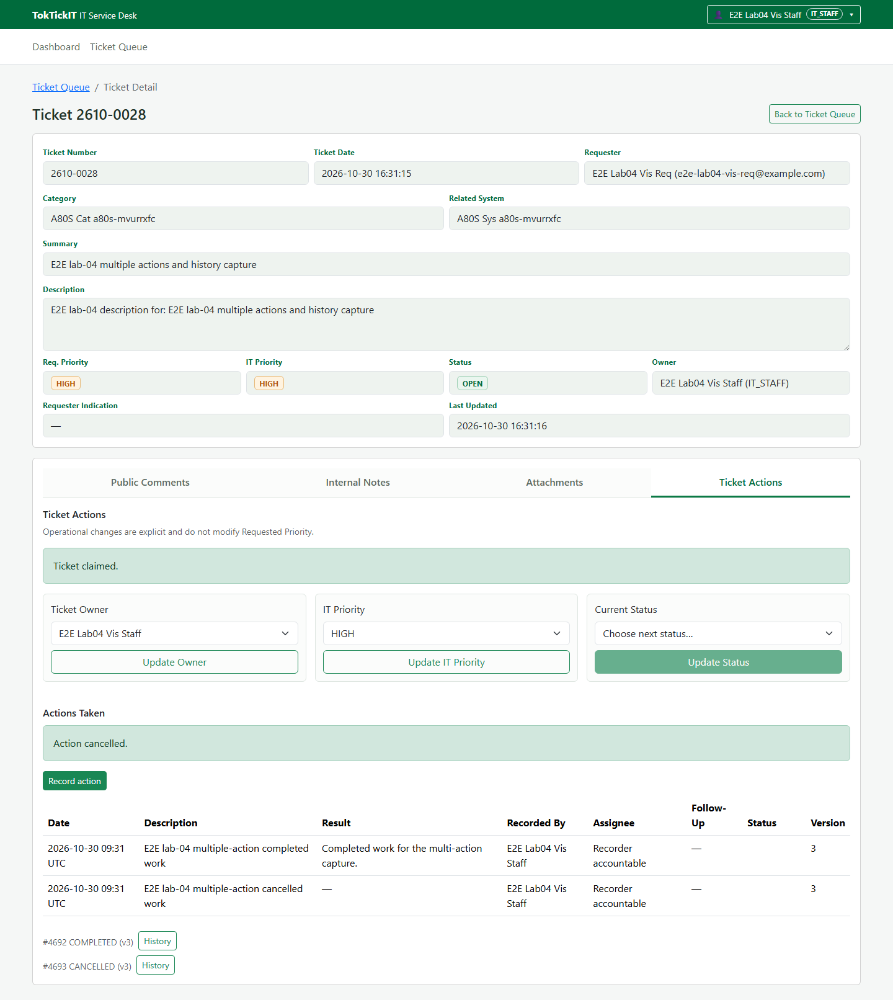
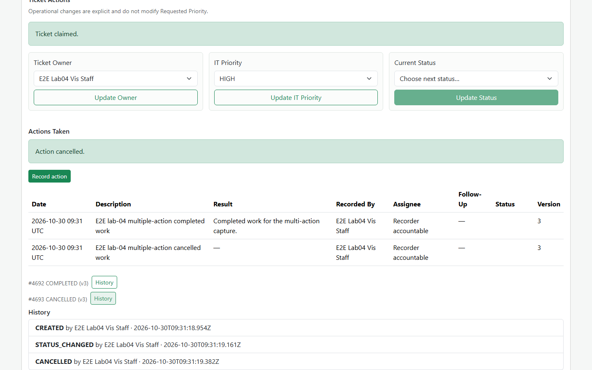

# TokTickIT — Lab 4 Submission (Draft)

> Draft status: release PR approval/merge and the main push CI evidence are not available yet. Do not treat this draft as the final submission or render the final PDF until those gates are complete.

## Answer Part 1:

### Project and release record

The release branch is `feature/31-release-integration`, based on `lab4-staging`. The owner approved plan rev14 before BUILD. See the [reviewer record](https://github.com/Peepipat-Suesoongnuen/TokTickIT/blob/main/docs/lab-04/reviewer.md) for reviewed PR history. The release PR, its exact reviewed head, approval, merge commit, final board state, and final README/ignore evidence remain to be appended after their gates.

## Answer Part 2:

The Lab 4 requirements and technical contracts are recorded in the [specification](https://github.com/Peepipat-Suesoongnuen/TokTickIT/blob/main/docs/lab-04/specification.md), [API specification](https://github.com/Peepipat-Suesoongnuen/TokTickIT/blob/main/docs/lab-04/api-spec.md), and [UI specification](https://github.com/Peepipat-Suesoongnuen/TokTickIT/blob/main/docs/lab-04/ui-spec.md). These documents define the scope and verification criteria for this release.

## Answer Part 3:

The [test plan](https://github.com/Peepipat-Suesoongnuen/TokTickIT/blob/main/docs/lab-04/tests.md) maps acceptance criteria to tests and current evidence. Local verification includes the targeted E2E-02/E2E-03 Playwright run (2 passed on 2026-10-30), with other local results listed in the test plan and [evidence ledger](https://github.com/Peepipat-Suesoongnuen/TokTickIT/blob/main/artifacts/lab-04/evidence/evidence-ledger.md).

**Main release output:** pending. Record the E-16 push-run URL/ID, four job conclusions, and the exact `MAIN_MERGE` pin after release merge and successful hosted CI. No final-main result is claimed here.

## Answer Part 4:

AI tools, models, prompt summaries, and reflection are documented in the [AI use record](https://github.com/Peepipat-Suesoongnuen/TokTickIT/blob/main/docs/lab-04/ai-use.md). The owner reported using OpenCode and Codex with luna 6, deepseek 4.1, and GLM 5.3.

## Answer Part 5:

Dashboard metric-to-dataset verification is summarized in the [metric-vs-DB evidence](https://github.com/Peepipat-Suesoongnuen/TokTickIT/blob/main/artifacts/lab-04/evidence/metrics-db-match.md). The record includes the direct database comparison and test output reference.

## Answer Part 6:

The Actions Taken evidence includes list, create, lifecycle, completion, cancellation, and history states:

## Answer Part 7:

Action lifecycle ordering, role visibility, and append-only history are covered by the [API specification](https://github.com/Peepipat-Suesoongnuen/TokTickIT/blob/main/docs/lab-04/api-spec.md), the tests listed in the [test plan](https://github.com/Peepipat-Suesoongnuen/TokTickIT/blob/main/docs/lab-04/tests.md), and the history evidence shown above.

## Answer Part 8:

Requester dashboard ownership and drill-down behavior are covered by the [test plan](https://github.com/Peepipat-Suesoongnuen/TokTickIT/blob/main/docs/lab-04/tests.md) and [metric-vs-DB evidence](https://github.com/Peepipat-Suesoongnuen/TokTickIT/blob/main/artifacts/lab-04/evidence/metrics-db-match.md). Local dashboard E2E verification passed; exact-main hosted verification remains pending.

## Answer Part 9:

Responsive and accessibility requirements are described in the [UI specification](https://github.com/Peepipat-Suesoongnuen/TokTickIT/blob/main/docs/lab-04/ui-spec.md). The [visual/a11y checklist](https://github.com/Peepipat-Suesoongnuen/TokTickIT/blob/main/artifacts/lab-04/evidence/visual-a11y-checklist.md) records the checks and screenshot inventory. Final rendered screenshots and PDF fidelity checks remain before submission.
